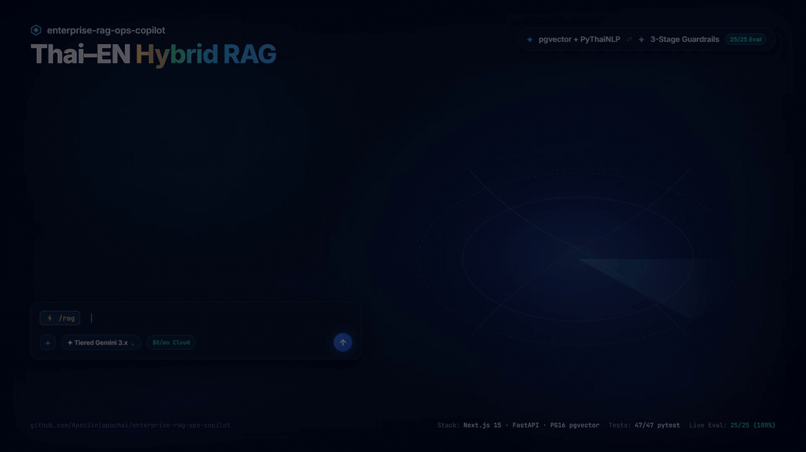
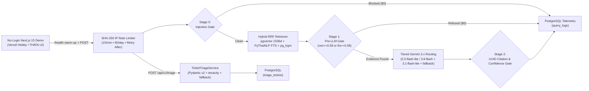

# 🤖 Enterprise RAG Ops Copilot (`enterprise-rag-ops-copilot`)

> **Production-Minded Thai–English Hybrid RAG Copilot, Pydantic v2 Support Ticket Triage API, and 25-Case Golden Eval Gate** with a No-Login Next.js Live Demo (`$0` Free-Tier Stack).

[](https://enterprise-rag-ops-copilot.vercel.app/)
[](https://enterprise-rag-ops-copilot-api.onrender.com/health)
[](#golden-evaluation-gate-ci--live-production-verified)
[](#golden-evaluation-gate-ci--live-production-verified)
[](#free-tier-deployment-guide-0-stack)

🔗 **Live Demo:** [https://enterprise-rag-ops-copilot.vercel.app/](https://enterprise-rag-ops-copilot.vercel.app/)  
🩺 **Live API Health:** [https://enterprise-rag-ops-copilot-api.onrender.com/health](https://enterprise-rag-ops-copilot-api.onrender.com/health)

<p align="center">
  <a href="https://enterprise-rag-ops-copilot.vercel.app/">
    
  </a>
  <br />
  <sub><em>Click preview to open the No-Login Live Demo — Thai–English Hybrid RAG, 3-Stage $0 Guardrails, Pydantic v2 Ticket Triage &amp; 25-Case Golden Eval</em></sub>
</p>

---

## ✨ Core Capabilities

- **Thai–English Hybrid Search (`pgvector` + `PyThaiNLP` + `pg_trgm` RRF):** Combines 1536-dim L2-normalized `gemini-embedding-001` cosine search, PyThaiNLP (`newmm`) word-segmented PostgreSQL `tsvector` FTS with B2B SaaS domain stopword filtering, and `pg_trgm` exact SKU/error-code boosting (`INV-2026-0091`, `ERR-503`, `ERR-AUTH-403`) via Reciprocal Rank Fusion (`0.6 / (60 + vec_rank) + 0.4 / (60 + fts_rank)`).
- **Tiered Gemini 3.x Model Routing & Resilience:** Routes default RAG and triage requests to the Fast Path (`gemini-3.5-flash-lite`) and escalates multi-doc/comparison/gray-zone RAG or PDPA/multi-entity triage to the Complex Path (`gemini-3.8-flash`), with automatic `gemini-3.1-flash-lite` fallback and deterministic grounded extractive / rule-based fallbacks on `429 RESOURCE_EXHAUSTED`.
- **3-Stage Anti-Hallucination & Security Guardrails:**
  - **Stage 0 (Injection Gate — `$0` LLM spend):** Deterministic bilingual regex screen blocking English & Thai prompt injections (`BLOCKED_INJECTION`).
  - **Stage 1 (Pre-LLM Retrieval Gate — `$0` LLM spend):** Refuses low-evidence queries (`max_vec_similarity < 0.58` and `max_fts_rank < 0.08`) before calling Gemini (`REFUSED_LOW_EVIDENCE`).
  - **Stage 2 (Post-LLM Groundedness Gate):** Verifies `cited_chunk_ids` against retrieved PostgreSQL UUIDs and enforces `confidence_score >= 0.55`; overrides ungrounded responses with zero fabricated citations.
- **Pydantic v2 Structured Ticket Triage:** Enforces strict enums, `StrictInt` urgency (`1–5`), explicit Gemini-compatible entity schema (`TriageTicketLLMOutput`), deterministic synthetic entity extraction, `tenacity` retry (`repaired_retry`), and automatic bilingual fallback (`deterministic_fallback`).
- **Public No-Login Demo Guardrails:** Thread-safe SHA-256 IP-hashed sliding-window rate limiter (`15 req/min`, `60 req/day`, bounded key memory) with `Retry-After` HTTP `429` headers (exposed via CORS), strict payload bounds (`500` chars RAG / `1500` chars Triage), synchronous FastAPI threadpool handlers for `psycopg_pool`, and `/health` cold-start warm-up ping.
- **Automated 25-Case Golden Eval Gate & 47-Test CI:** Evaluates 6 Thai, 5 English, 4 Code-Mixed, 4 Out-of-Scope, 3 Prompt Injection, and 3 Ticket Triage cases alongside `47/47` verified `pytest` tests in GitHub Actions (`ruff`, `pytest`, PostgreSQL 16 DDL, Docker build, Next.js build).

---

## 🏛️ System Architecture



---

## 📊 Golden Evaluation Gate (CI & Live Production Verified)

| Metric | Target | `ci_mock` Mode | Live Production (`production-live-38`) |
| :--- | :---: | :---: | :---: |
| **Total Cases** | `25` (6 TH, 5 EN, 4 Mixed, 4 OOS, 3 Injection, 3 Triage) | **25 / 25** | **25 / 25** |
| **Citation Hit Rate** | `>= 0.8500` | **1.0000** | **1.0000** |
| **Refusal Precision** | `= 1.0000` | **1.0000** | **1.0000** |
| **Injection Block Rate** | `= 1.0000` | **1.0000** | **1.0000** |
| **JSON Schema Pass Rate** | `= 1.0000` | **1.0000** | **1.0000** |
| **Avg / P95 Latency** | `<= 250 ms` (`ci_mock`) / `<= 3500 ms` (`live_gemini`) | **36 ms / 48 ms** | **767 ms / 1516 ms** |

---

## 🔌 API Reference

| Method & Path | Description | Auth / Guardrails |
| :--- | :--- | :--- |
| `GET /health` | Liveness & PostgreSQL connectivity probe (`status`, `version`, `database_connected`) | Public (used for Render cold-start wake-up) |
| `POST /api/v1/rag/query` | 3-stage guarded Thai–English Hybrid RAG query (`max 500 chars`) | IP-hashed rate limit (`15/min`, `60/day`) |
| `POST /api/v1/triage` | Structured Pydantic v2 ticket classification & entity extraction (`max 1500 chars`) | IP-hashed rate limit (`15/min`, `60/day`) |
| `GET /api/v1/documents` | Active knowledge corpus inventory & chunk counts | Public |
| `POST /api/v1/ingest` | Re-chunk, tokenize, embed, and upsert `data/mock_docs/` | Constant-time `X-Admin-Token` header |
| `GET /api/v1/eval/latest` | Latest Golden Eval Gate summary & 25 per-case results | Public |

---

## 🏗️ Repository Layout

```text
enterprise-rag-ops-copilot/
├── .github/workflows/ci.yml            # Ruff, Pytest, PG16 DDL, 25-Case Eval Gate, Docker, Next.js build
├── docs/assets/demo-60s.gif            # 1280x720 walkthrough preview generated from live API outputs
├── sql/
│   ├── 001_schema.sql                  # PostgreSQL 16 + pgvector + pg_trgm DDL (6 tables)
│   └── 002_hybrid_search_query.sql     # Reference RRF hybrid search CTE
├── data/mock_docs/                     # 12 Thai/EN/bilingual B2B SaaS Ops knowledge docs (52 chunks)
├── eval/
│   ├── golden_eval_set.json            # 25-case Thai/EN/Mixed/OOS/Injection/Triage benchmark
│   ├── thresholds.json                 # CI pass/fail thresholds
│   └── run_eval.py                     # CLI & programmatic eval runner (ci_mock, hybrid_replay, live_gemini)
├── api/
│   ├── Dockerfile                      # Multi-stage python:3.12-slim container ($PORT aware)
│   ├── pyproject.toml                  # Dependencies, Ruff, Pytest config
│   └── app/
│       ├── config.py                   # Pydantic BaseSettings & guardrail thresholds
│       ├── db.py                       # psycopg3 ConnectionPool + health probe
│       ├── main.py                     # FastAPI app, CORS (exposes Retry-After), /health, v1 routers
│       ├── routers/                    # Sync threadpool routes: rag, triage, documents, eval
│       ├── schemas/                    # Pydantic v2 contracts (1:1 with SQL CHECK constraints)
│       └── services/                   # tokenizer, embeddings, guardrails, retriever, generator, rate_limiter, triage_service
├── web/                                # Next.js 15 App Router + TypeScript + Tailwind CSS (No-Login Demo)
├── scripts/
│   ├── ingest_corpus.py                # CLI to chunk, tokenize, embed, and upsert data/mock_docs/
│   ├── generate_demo_gif.py            # Renders live API responses into 1280x720 demo-60s.gif
│   └── record_demo_gif.ps1             # FFmpeg 2-pass palette converter for screen recordings
├── tests/
│   ├── unit/                           # Schema, config, tokenizer, embeddings, guardrails, rate limiter & triage tests
│   ├── integration/                    # Live PG16 pgvector + RRF + end-to-end RAG pipeline tests
│   └── eval/                           # Live 25-case Golden Eval Gate & API persistence tests
├── render.yaml                         # Render Free Web Service Blueprint
├── docker-compose.yml                  # pgvector/pgvector:pg16 + FastAPI service
└── .env.example                        # Safe configuration placeholders
```

---

## 🚀 Local Quickstart

```bash
# 1. Start PostgreSQL 16 + pgvector
docker compose up -d postgres

# 2. Ingest mock corpus, run lint, tests & Golden Eval Gate
cd api
uv venv --python 3.13
uv pip install -e ".[dev]"
python ../scripts/ingest_corpus.py
pytest -v
python ../eval/run_eval.py --mode ci_mock
ruff check app ../tests ../scripts ../eval

# 3. Start API & No-Login Next.js Live Demo
uvicorn app.main:app --reload --port 8000
# In a second terminal:
cd web
cp .env.example .env.local
npm install
npm run dev
# Open http://localhost:3000
```

---

## ☁️ Free-Tier Deployment Guide (`$0` Stack)

1. **Database (Supabase Free Tier):**
   - Create a Supabase project, open SQL Editor, and execute [`sql/001_schema.sql`](sql/001_schema.sql).
   - Copy the Postgres connection string (Session Pooler or Direct URI with `sslmode=require`) as `DATABASE_URL`.
2. **Backend API (Render Free Web Service via `render.yaml`):**
   - Connect this repository on Render using the root [`render.yaml`](render.yaml) Blueprint.
   - Set secret environment variables `DATABASE_URL`, `GEMINI_API_KEY`, `ADMIN_INGEST_TOKEN`, and update `CORS_ORIGINS` to your Vercel production URL.
   - Populate the corpus and initial eval run once deployed:
     ```bash
     curl -X POST https://<your-render-api>.onrender.com/api/v1/ingest \
       -H "X-Admin-Token: <your-admin-token>"
     ```
3. **Frontend (Vercel Hobby):**
   - Import the repository in Vercel with Root Directory set to `web`.
   - Set `NEXT_PUBLIC_API_BASE_URL=https://<your-render-api>.onrender.com`.
   - Deploy; the frontend automatically pings `GET /health` on load to wake up the Render Free instance.
