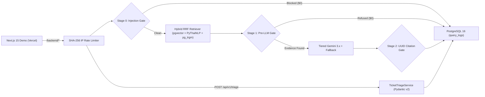

# SPEC — Enterprise RAG Ops Copilot (`enterprise-rag-ops-copilot`)

- **Status:** Shipped
- **Owner:** Apec Sinlapachai
- **Last Updated:** 2026-11-26

---

## 1. Problem & Goal
- **Problem:** B2B SaaS support and operations teams in Thailand handle bilingual (Thai, English, and code-mixed) policy, SLA, billing, and runbook queries containing exact error codes/SKUs (`INV-2026-0091`, `ERR-503`, `ERR-AUTH-403`). Pure vector RAG frequently misses exact codes and Thai compound words, hallucinates on out-of-scope questions, and leaks cost when prompt injections or low-evidence queries hit LLMs.
- **Goal:** Deliver a production-minded, `$0`-hosted **Thai–English Hybrid RAG Copilot**, **Pydantic v2 Support Ticket Triage API**, and **25-Case Automated Golden Eval Gate** with verifiable groundedness (`>= 85%` citation hit rate, `100%` refusal precision, `100%` injection block rate, `100%` triage JSON schema pass rate) and a No-Login Next.js live demo.

---

## 2. Scope Guardrails (Anti-Scope Creep)
### In-Scope (Must Build)
- [x] PostgreSQL 16 (`pgvector` + `pg_trgm` + `tsvector`) hybrid retrieval combining 1536-dim L2-normalized `gemini-embedding-001`, `PyThaiNLP (newmm)` word-segmented FTS, and exact SKU/code trigram boosting via RRF (`sql/002_hybrid_search_query.sql`).
- [x] 3-Stage anti-hallucination & security guardrails: Stage 0 Injection Gate (`$0`), Stage 1 Pre-LLM Retrieval Gate (`$0`), Stage 2 Post-LLM UUID Citation & Confidence Gate.
- [x] Tiered Gemini 3.x routing (`gemini-3.5-flash-lite` fast path, `gemini-3.8-flash` complex path, `gemini-3.1-flash-lite` fallback, and deterministic grounded extractive fallback on `429`).
- [x] Structured Pydantic v2 Support Ticket Triage (`POST /api/v1/triage`) with `tenacity` retry, deterministic entity extraction, and `triage_tickets` persistence.
- [x] 25-case Golden Eval Gate (`eval/golden_eval_set.json`, `eval/run_eval.py`, `eval/thresholds.json`) enforced in GitHub Actions CI.
- [x] Public No-Login Next.js 15 Demo (`web/`) routed through a same-origin `/backend/*` proxy with cold-start `/health` polling and IP-hashed rate limiting (`15 req/min`, `60 req/day`).

### Out-of-Scope (Explicitly Not Building Now)
- Multi-tenant authentication, RBAC, or user-uploaded production documents in the public demo.
- Separate managed vector database (Pinecone, Qdrant, Weaviate) — consolidated inside PostgreSQL 16 for `$0` hosting and transactional telemetry.
- Streaming token-by-token SSE responses (deferred to preserve strict post-LLM UUID citation validation before displaying answers).

---

## 3. Architecture & Data Flow

- **Inputs:** `POST /api/v1/rag/query` (`query` 1–500 chars, optional `lang`), `POST /api/v1/triage` (`ticket_text` 5–1500 chars), `POST /api/v1/ingest` (`X-Admin-Token`). See `api/app/schemas/` for executable contracts.
- **Outputs:** Grounded answer + verified `citations[]` + `guardrail_status` + latency/cost telemetry, or deterministic refusal/fallback on low evidence, injection, or `429`.

---

## 4. Acceptance Criteria (Definition of Done)
1. **Given** an in-scope Thai, English, or code-mixed query (including exact SKU/error codes), **when** sent to `POST /api/v1/rag/query`, **then** the retriever returns relevant chunks and the response achieves `>= 0.85` Citation Hit Rate across the 15 in-scope Golden Eval cases.
2. **Given** an out-of-scope query or bilingual prompt injection, **when** sent to `POST /api/v1/rag/query`, **then** Stage 0/1 blocks or refuses at `$0` LLM spend with `0` fabricated citations (`1.00` Refusal Precision & `1.00` Injection Block Rate).
3. **Given** a support ticket payload, **when** sent to `POST /api/v1/triage`, **then** the API returns a 1:1 SQL-aligned `TriageTicketResponse` (`1.00` JSON Schema Pass Rate) even under Gemini `429` fallback.
4. **Given** CI runs on push/PR, **then** `ruff`, `pytest` (unit + live PG16 integration + eval gate), `eval/run_eval.py --mode ci_mock`, `docker compose config -q`, Docker build, and Next.js `tsc` + `next build` all pass with exit code `0`.

---

## 5. Non-Functional Requirements & Guardrails
- **Cost / Quota Cap:** `$0/mo` hosting (Vercel Hobby + Render Free + Supabase Free); IP-hashed rate limiting (`15/min`, `60/day`, bounded key memory) + deterministic fallback on `429`.
- **Latency:** P95 `<= 250 ms` (`ci_mock`) / `<= 3500 ms` (`live_gemini`).
- **Security & PDPA:** Zero real PII in corpus/fixtures; constant-time `hmac.compare_digest` on `X-Admin-Token`; strict `CORS_ORIGINS` exposing `Retry-After`; same-origin `/backend/*` proxy.
- **Observability:** Every RAG query, triage ticket, and eval run is persisted in PostgreSQL (`query_logs`, `triage_tickets`, `eval_runs`) with model name, latency, and estimated USD cost.
